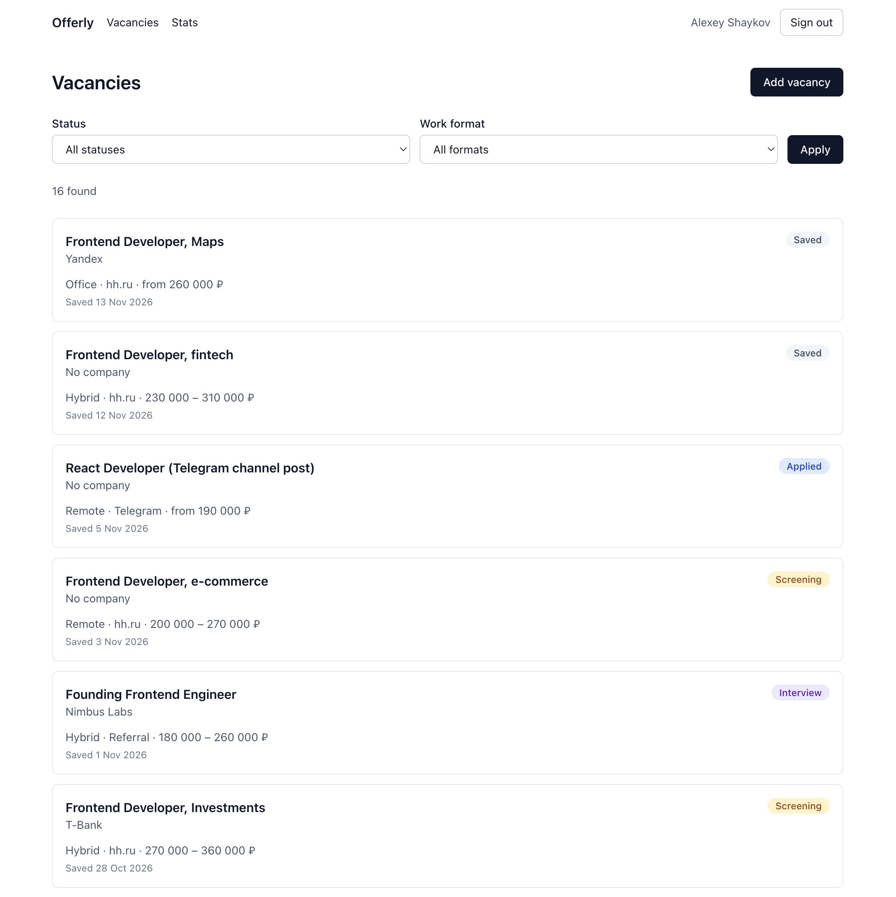

# Offerly

A job application tracker. Keep a list of vacancies, move each one through the hiring funnel, see where your applications stand.

**Live demo: <https://offerly-topaz.vercel.app/>**. Sign in with any GitHub account; a new account starts with sample vacancies. Signing in stores your GitHub name, email and avatar in the demo database, and nothing else.



This is a portfolio project built to show how I work with the **Next.js App Router**: Server and Client Components, Server Actions, route handlers, middleware, rendering and caching strategies, a real database, tests and CI. The sections below explain the decisions, not just the features.

## Features

- Sign in with GitHub (Auth.js v5), all routes of the app are protected by middleware
- Vacancy list with filters (status, work format) kept in the URL, and pagination
- Create and edit a vacancy, with one validation schema shared by the form and the server
- Change a vacancy status with an optimistic update; every change is recorded in a history
- Statistics page: application funnel with conversion and applications per week
- `POST /api/vacancies` REST endpoint for external clients
- Optional demo data: a new account can be filled with sample vacancies on its first sign-in (`DEMO_DATA_ON_SIGNUP=true`), so a visitor never lands on an empty app

## Stack

Next.js 15 (App Router) · React 19 · TypeScript (strict) · PostgreSQL 16 · Prisma · Auth.js · Tailwind CSS 4 · Zod · React Hook Form · TanStack Query (only for the optimistic status update) · Vitest + Testing Library · Playwright · GitHub Actions

## Architecture decisions

The table is the short version: what I chose, why, and what it costs. The subsections below explain the main ones in detail.

| Decision                                                         | Why                                                                            | Trade-off                                                                      |
| ---------------------------------------------------------------- | ------------------------------------------------------------------------------ | ------------------------------------------------------------------------------ |
| Feature-Sliced layers with ESLint-enforced boundaries            | One direction of dependencies, easy to find things, no import cycles           | More folders than a small app strictly needs                                   |
| Two entry points per slice (`index.ts` and `server.ts`)          | Keeps Prisma out of the browser bundle by construction                         | A deliberate exception to "export only through `index.ts`"                     |
| JWT sessions plus the Prisma adapter                             | Middleware runs on the edge and can verify the session without a database call | The `Session` table stays empty and sessions cannot be revoked server-side     |
| One Zod schema for the form, the Server Action and the REST body | Validation rules live in exactly one place                                     | REST needs a thin adapter, because JSON clients send numbers and `null`        |
| Status change as one transaction with a conditional update       | History can never contradict the vacancy, and concurrent changes are safe      | Slightly more code than a plain `update`                                       |
| Transition rules injected into the database layer                | `entities` never imports from `features`                                       | An extra function parameter                                                    |
| `unstable_cache` per user instead of page-level ISR              | The page reads the session, so it is dynamic and `revalidate` would do nothing | Data is cached, not HTML; tag-based invalidation to maintain                   |
| TanStack Query only for the optimistic status control            | Everything else is loaded in Server Components, no client cache needed         | Two ways of holding state in one app, kept to a single feature                 |
| Company as free text with find-or-create                         | Simple form, no extra screens                                                  | No unique constraint on `(userId, name)`, so a race can create a duplicate     |
| Offset pagination (`skip`/`take`)                                | Simple, indexes cover it, fine for hundreds of rows                            | Would not scale to very large lists; cursors would                             |
| Test-only Credentials provider for E2E                           | GitHub OAuth cannot run in automated tests                                     | Guarded by an env flag **and** `NODE_ENV`, never present in a production build |
| Direct (non-pooled) Neon connection                              | Works with `prisma migrate deploy` without a `directUrl`                       | No connection pooling for serverless at higher load                            |
| Salary as a whole number of rubles                               | Enough for filtering and display                                               | No currencies                                                                  |

### Feature-Sliced Design adapted to the App Router

```
app → features → entities → shared
```

A layer may only import from the layers below it, and this is enforced by ESLint (`no-restricted-imports`), not by convention.

| Layer      | Contents                                                                                           |
| ---------- | -------------------------------------------------------------------------------------------------- |
| `app`      | Routing only: pages, layouts, `loading`/`error`, route handlers                                    |
| `features` | User actions: `create-vacancy`, `edit-vacancy`, `change-status`, `filter-vacancies`, `auth`        |
| `entities` | The `vacancy` entity: model (types, Zod schemas, rules), api (database access), ui (cards, badges) |
| `shared`   | Database client, auth config, UI kit, helpers that know nothing about the domain                   |

Pages stay thin: they read the session and `searchParams`, call a function from `entities`, and compose components from `features`.

### Server and Client Components

Everything is a Server Component by default. `'use client'` appears only on leaf components that need browser features: the vacancy form, the status control, the query provider. The filter form is a plain `<form method="get">`, so filters live in the URL, work without JavaScript and can be shared as a link.

The `vacancy` slice has two entry points on purpose: `@/entities/vacancy` is safe for the browser, `@/entities/vacancy/server` holds the Prisma queries and is marked `server-only`. Without that split, a client component importing a badge would drag the database client into the browser bundle.

### Data access and authorization

- The Prisma client lives in `shared/lib/db` and is imported only in server code (`import 'server-only'`).
- Every query is scoped by the `userId` from the session. Someone else's vacancy looks exactly like a missing one (`404`).
- Pages load data directly through functions from `entities/*/api`; server code never calls its own route handlers.

### Server Actions and the REST endpoint share one pipeline

Both do the same steps: check the session → validate with Zod → check ownership → write → revalidate caches. A Server Action returns a typed `{ ok, data } | { ok: false, error }` and never throws into the UI. The route handler maps the same outcomes to HTTP codes and a single error format, `{ error: { code, message, details? } }`.

The REST body is validated by a thin adapter schema (JSON clients send numbers and `null`) that feeds the **same** form schema, so the rules exist in exactly one place. Requiring `Content-Type: application/json` keeps cross-site form posts out.

### Status changes

Changing a status and writing its `StatusChange` record happen in **one transaction**. The update is conditional on the status that was read (`updateMany … where status = from`), so a concurrent change cannot produce a history that contradicts reality. Transition rules (forward-only along the funnel, archive from anywhere, restore only to `SAVED`) are pure functions with their own tests; the database layer receives them as a parameter so that `entities` never imports from `features`.

On the client, the status control keeps an optimistic value in the TanStack Query cache, rolls back on failure and refreshes server components afterwards so the history updates.

### Statistics and caching

The statistics are different for every user, and the page reads the session, which makes it dynamic. A page-level `revalidate = 3600` would therefore do nothing, so I did not pretend otherwise: the calculation is cached **per user** with `unstable_cache` for an hour and invalidated by tag whenever a status changes or a vacancy is created. The funnel treats a stage as reached when a vacancy was in it or in any later stage, because transitions may skip steps.

### Testing strategy

- **Unit**: Zod schemas, transition rules, funnel and week calculations, filter parsing. These are pure functions, so the tests are fast and precise.
- **Component** (Testing Library): the vacancy form (validation, server errors, submit state) and the optimistic status control (including rollback).
- **End to end** (Playwright): sign-in, creating a vacancy, changing status, filtering, redirects for anonymous users.

GitHub OAuth cannot run in automated tests, so there is a test-only Credentials provider. It exists only when `E2E_TEST_MODE=true` **and** `NODE_ENV` is not `production`, and it is registered on the server side only. E2E runs against a separate `offerly_test` database on its own dev server, so it never touches development data.

## Getting started

Requirements: Node 20+, pnpm 10, Docker.

```bash
pnpm install
cp .env.example .env     # then fill in the values below
pnpm db:up               # PostgreSQL 16 in Docker
pnpm db:migrate          # apply migrations
pnpm db:seed             # demo data
pnpm dev                 # http://localhost:3000
```

1. Generate `AUTH_SECRET`: `openssl rand -base64 32`.
2. Create a GitHub OAuth App (GitHub → Settings → Developer settings → OAuth Apps). Homepage URL `http://localhost:3000`, callback URL `http://localhost:3000/api/auth/callback/github`. Put the client ID and secret into `AUTH_GITHUB_ID` and `AUTH_GITHUB_SECRET`.
3. Either set `DEMO_DATA_ON_SIGNUP=true` before your first sign-in, or sign in once, then set `SEED_USER_EMAIL` to your email and run `pnpm db:seed` to get demo vacancies on your own account. Note that this replaces that user's vacancies and companies.

### Commands

| Command                                               | What it does                                            |
| ----------------------------------------------------- | ------------------------------------------------------- |
| `pnpm dev` / `build` / `start`                        | Development server, production build, production server |
| `pnpm lint` / `typecheck`                             | ESLint, `tsc --noEmit`                                  |
| `pnpm test` / `test:watch`                            | Unit and component tests (Vitest)                       |
| `pnpm test:e2e`                                       | Playwright (needs `pnpm db:up`)                         |
| `pnpm db:up` / `db:migrate` / `db:seed` / `db:studio` | Docker Postgres, migrations, demo data, Prisma Studio   |

CI (GitHub Actions) runs lint, typecheck, unit tests and build in one job, and the end-to-end tests against a Postgres service in another.

## Deployment (Vercel + Neon)

1. **Neon**: create a project (PostgreSQL 16) and copy the **direct** connection string, the one without the pooler. It already contains `sslmode=require`. Pick the region that matches your Vercel Functions region (see step 4), because every database query goes from the function to Neon.
2. **GitHub OAuth App** for production: callback URL `https://<your-domain>/api/auth/callback/github`.
3. **Vercel**: import the repository. The framework is detected automatically, and Vercel runs the `vercel-build` script. Add these environment variables:
   - `DATABASE_URL`: the Neon string from step 1
   - `AUTH_SECRET`: a new random value, different from local
   - `AUTH_GITHUB_ID`, `AUTH_GITHUB_SECRET`: from the production OAuth App
   - `DEMO_DATA_ON_SIGNUP=true` (optional): fill every new account with demo data on its first sign-in
4. In the Vercel project settings (Functions → Region) set the function region to the one next to your Neon database, for example Frankfurt (`fra1`) with Neon `eu-central-1`. The default is Washington (`iad1`), and a database on another continent adds a noticeable delay to every page.
5. Deploy. Migrations (`prisma migrate deploy`) run automatically, **only for the Production environment**, so preview deployments never change the database schema.

Preview deployments get random URLs that the OAuth App will not accept, so sign-in works only in production unless you add a stable preview domain.

## Project structure

```
src/
  app/            routing: pages, layouts, loading/error, api/vacancies, api/auth
  features/       auth, change-status, create-vacancy, edit-vacancy, filter-vacancies
  entities/       vacancy: api/, model/, ui/, lib/
  shared/         ui/, lib/ (db, auth, query provider, action and api result helpers)
  middleware.ts   protects /vacancies and /stats
prisma/           schema, migrations, seed
e2e/              Playwright tests and global setup
knowledge/        short write-ups of the design decisions (in Russian)
```

## What is intentionally not implemented

- **Cover letter generation.** The `CoverLetter` model and its display exist (the seed creates a few), but there is no LLM integration.
- **Error monitoring.** No Sentry or similar.
- **Personal API tokens.** The REST endpoint authenticates with the browser session cookie, so it fits same-site use. Tokens would need a new table.
- **`GET` and `PATCH` endpoints.** Only `POST /api/vacancies` exists, because creating a vacancy is the one case an external client (say, a browser extension) would really need.
- **Currencies.** Salaries are whole numbers in rubles per month.
- **Pooled database connections.** Deployment uses a direct Neon connection, which is fine at this scale. Pooling would require a `directUrl` in the Prisma datasource.
